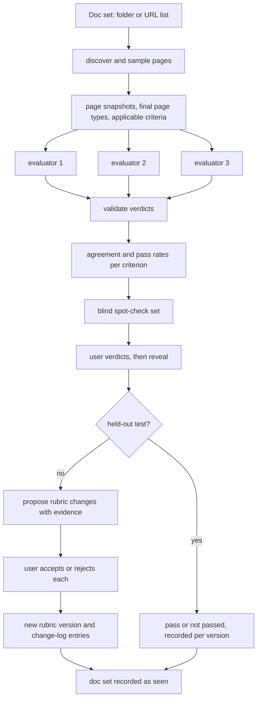

# Documentation Quality Rubric Loop - Plan

## Goal Capsule

- **Objective:** The user holds a documentation-quality rubric that has been tested against real public docs, and can run it on new documentation to get an evidenced quality report.
- **Means:** A Claude Code skill with two modes, `refine-rubric` and `review`, sharing one rubric (KTD1, KTD2).
- **Authority:** The Product Contract decides product behavior. Key Technical Decisions decide mechanism within it. Units override neither. The user is the sole owner of the rubric, and nothing changes it without their approval.
- **Execution profile:** New code in an empty repository, shipped as one pull request. Python standard library only; no services, no credentials.
- **Stop conditions:** Stop and report if a requirement cannot be met without a third-party dependency, or if the host cannot spawn subagents with separate contexts (R6 depends on it).
- **Finishing:** The executor implements, verifies and commits; the caller ships.
- **Open blockers:** None.

---

## Product Contract

### Summary

A Claude Code skill that evaluates written technical documentation against a rubric covering page structure, usability by reading, and sentence-level clarity.
`refine-rubric` mode sharpens the rubric by running several independent evaluators over a public doc set and using their disagreements, plus the user's spot-checks, to propose rubric changes.
`review` mode applies the current rubric to new documentation, supplied as a PDF or as docs in a code repository, and reports verdicts with evidence.
The skill never edits the documentation it evaluates.

### Problem Frame

The user wants to learn what good technical documentation looks like by studying other people's public docs, and to carry that judgement into their own writing.

A rubric written once from first principles is untested. Nothing shows which criteria are vague, which are wrong, and which only fit the docs the author happened to have in mind. Model-assigned quality scores make this worse: they drift between runs and are not tied to any human judgement.

The starting point for this work was a four-layer evaluate-and-fix design (coverage, structure, usability, sentences) built around improver agents, per-page pass bars and an issue-tracking state file. It assumed the user owned the docs, had support-ticket and search data to build a task list, and had a live product to execute steps against. None of that holds for public docs the user does not own, and the design had no mechanism for checking whether its evaluators were right.

### Key Decisions

- **Evaluate only, never fix.** The user's goal is judgement they can trust, and fixing machinery was most of the original design's complexity. Governs R1. (session-settled: user-directed — chosen over a full evaluate-fix-verify loop with improver agents: the goal is trustworthy judgement, not rewriting)
- **The rubric is the product.** Reports and run outputs exist to improve or apply the rubric, not as ends in themselves. Governs R2, R9. (session-settled: user-directed — chosen over per-doc-set teardown reports or a cumulative playbook: the user wants criteria to apply to their own docs)
- **Evaluator disagreement plus blind user spot-checks is the refinement signal.** Disagreement is cheap and automatic; spot-checks supply the human judgement that disagreement alone cannot. Governs R6, R7, R8. (session-settled: user-approved — chosen over the user rating a sample themselves every run, or known-good versus known-bad doc sets: low ongoing effort with human judgement kept in the loop)
- **Yes/no criteria with quoted evidence replace 0-10 scores.** Numeric scores are noisy and cannot be argued with; a quoted passage can. Governs R3.
- **The user approves every rubric change.** Left to itself the loop would drift toward criteria that evaluators find easy to agree on. Governs R9, R10. (session-settled: user-approved — chosen over the loop editing the rubric itself with after-the-fact review: unattended edits drift toward agreeable criteria)
- **Three dimensions in the first version.** Coverage needs task data the user does not have for other people's docs, and accuracy needs product access. Governs R4. (session-settled: user-directed — chosen over including doc-set coverage: no task or support data exists for other people's docs)
- **The rubric is done when it holds up on docs it has never seen and its criteria still tell pages apart.** Testing on tuning docs would only show it fits them, and agreement alone rewards criteria that never fail. Governs R11, R12. (session-settled: user-approved — chosen over stopping when runs produce no more rubric edits: that can plateau on a mediocre or trivially agreeable rubric)
- **Two named modes, `refine-rubric` and `review`.** Refinement and application have different costs and outputs and should not be confused. Governs R6, R13. (session-settled: user-directed — chosen over the names refine and apply: the user's naming)
- **Review reads PDFs and documentation that lives in a code repository.** Checking docs against what the code does would bring accuracy back into scope. Governs R14. (session-settled: user-directed — chosen over evaluating whether docs match the code: accuracy is out of scope)
- **Reports state the last rubric version that passed and the changes since.** A per-version flag would reset on every accepted change. Governs R17. (session-settled: user-approved — chosen over a bare per-version passed or not-passed flag: the warning would otherwise lose meaning)

### Requirements

**Rubric**

- R1. The skill never modifies the documentation it evaluates.
- R2. One rubric is shared by both modes, and it carries a version that changes whenever its criteria change.
- R3. Every criterion is answerable yes or no, and every verdict quotes the passage that justifies it. A verdict that rests on something being absent instead names what was looked for and the page or section searched.
- R4. The rubric covers three dimensions: page structure, usability by reading, and sentence-level clarity.
- R5. The first rubric version is seeded from the Diátaxis page types and the Good Docs Project templates, and does not fail a page solely for mixing types when the page is a README, quickstart or landing page.

**refine-rubric mode**

- R6. A run takes one public doc set and has several independent evaluators judge the same pages against the current rubric without seeing each other's verdicts.
- R7. The run identifies the criteria on which evaluators disagreed and treats each as a candidate for revision.
- R8. The run gives the user a small set of page-and-criterion items to judge: the most contested ones, plus some where all evaluators agreed, drawn mainly from unanimous passes on usability criteria. The evaluators' verdicts and evidence for an item are revealed only after the user has recorded their own verdict.
- R9. The run ends with proposed rubric changes (reword, split, add, or drop a criterion), each with the evidence that motivated it.
- R10. No proposed change takes effect until the user accepts it, and each accepted change is logged with its reason.
- R11. The skill tracks which doc sets have been used in a refinement run or a held-out test. Such a doc set is seen and cannot be designated a held-out test again.
- R12. A run on an unseen doc set can be designated a held-out test, which reports evaluator agreement, the user's spot-check agreement and each criterion's pass rate, and proposes no rubric changes.

**review mode**

- R13. A review makes one pass over the supplied documentation with the current rubric and produces a report of per-criterion verdicts with their quoted evidence.
- R14. Review accepts a PDF, or documentation in a code repository: READMEs, Markdown docs folders, and docstrings and comments.
- R15. A PDF is divided into sections before review, and each section is reviewed as a page.
- R16. Page-structure criteria apply only to prose pages; docstrings and comments are reviewed on clarity and usability alone.
- R17. Every review report states the rubric version that produced it, the most recent version that passed a held-out test, and how many changes have been accepted since. For each kind of input reviewed (prose pages, PDF sections, docstrings and comments), it also states whether that held-out test included that kind.
- R18. Review never changes the rubric and never proposes rubric changes.

### Key Flows

- F1. Refine the rubric
  - **Trigger:** The user runs `refine-rubric` on a public doc set.
  - **Steps:** Evaluators judge the pages independently. The skill surfaces disagreements and the spot-check set. The user records their own verdict on each spot-check before seeing the evaluators'. The skill proposes rubric changes with evidence. The user accepts or rejects each. Accepted changes produce a new rubric version and a log entry.
  - **Outcome:** A revised rubric, and the doc set recorded as seen.
  - **Covered by:** R6, R7, R8, R9, R10, R11

- F2. Test the rubric on unseen docs
  - **Trigger:** The user runs a held-out test on a doc set not yet used for refinement.
  - **Steps:** Evaluators judge the pages independently. The user spot-checks as in F1. The skill reports evaluator agreement, user agreement and per-criterion pass rates.
  - **Outcome:** The rubric version is marked as having passed or not passed. The doc set is recorded as seen.
  - **Covered by:** R11, R12

- F3. Review new documentation
  - **Trigger:** The user runs `review` on a PDF or a repository.
  - **Steps:** The skill identifies the pages or sections to review, applies the criteria that fit each, and writes the report.
  - **Outcome:** A report the user reads; the rubric is unchanged.
  - **Covered by:** R13, R14, R15, R16, R17, R18

### Acceptance Examples

- AE1. **Covers R5.** Given a README that contains both a short tutorial and a reference table, when it is evaluated, then it is not failed on the single-type criterion.
- AE2. **Covers R8.** Given a run where evaluators were unanimous on most verdicts, when the spot-check set is built, then it still contains unanimous verdicts alongside the contested ones, most of them usability passes.
- AE3. **Covers R10.** Given a run that proposed four rubric changes, when the user accepts two and rejects two, then the new rubric version contains only the two accepted changes and the log records those two with their reasons.
- AE4. **Covers R11, R12.** Given a doc set already used in a `refine-rubric` run, when the user tries to designate it as a held-out test, then the skill tells them it has been seen and does not count the result as a pass.
- AE5. **Covers R16.** Given a repository with a docs folder and docstrings, when it is reviewed, then the report carries structure verdicts for the docs pages and none for the docstrings.
- AE6. **Covers R17.** Given that no rubric version has passed a held-out test, when a review report is produced, then the report says so prominently.
- AE7. **Covers R18.** Given a review in which the user disagrees with a verdict, when the review ends, then the rubric is unchanged and the report points the user to `refine-rubric` as the route for fixing a criterion.
- AE8. **Covers R17.** Given a rubric whose held-out test covered only prose pages, when docstrings are reviewed, then the report says that test did not cover docstrings.

### Success Criteria

- On a held-out doc set, independent evaluators mostly agree with each other, and the user agrees with the verdicts they spot-check.
- On that same doc set, each criterion fails on at least some pages, and the user judges those failures to matter.
- A review report lets the user find and reread every passage behind a failed criterion, or see what was looked for and where when the failure rests on absence, without opening the evaluator's reasoning.
- After several refinement runs, the user can explain why each criterion is worded as it is by reading the change log.

### Scope Boundaries

- Fixing, rewriting or proposing edits to the evaluated documentation.
- Accuracy: whether the docs match what the product or code does. A page can pass every criterion and still be wrong.
- Doc set coverage: whether the right pages exist and are prioritised.
- Executing documented steps against a real product.
- Mechanical style linting with Vale.
- Review findings feeding back into the rubric automatically.
- Comparing or ranking doc sets against each other.

### Dependencies / Assumptions

- The user can name enough public doc sets to keep some unseen for held-out tests. Each held-out test consumes one.
- "Usability by reading" is the weakest dimension. A model reader fills gaps a newcomer would trip on, and without executing steps only the user's spot-checks correct for that.
- Structure verdicts on PDFs will be less reliable than on web or Markdown pages, because sectioning a manual is itself a judgement.
- The Diátaxis framework and the Good Docs Project templates are publicly available to seed the rubric.

### Outstanding Questions

**Deferred to Implementation**

- The KTD6 thresholds, the KTD7 counts, and the rule that the user-agreement bar is measured on unanimous spot-checks are provisional. After the second refinement run the skill shows the observed baseline and has the user confirm or change them; held-out tests stay unavailable until then.

### Sources / Research

- Diátaxis documentation framework: https://diataxis.fr
- The Good Docs Project templates: https://www.thegooddocsproject.dev
- The four-layer evaluate-and-fix recommendation reviewed at the start of this work, which contributed the top-down ordering of concerns and the separation of evaluator from any agent that changes things.

---

## Planning Contract

Product Contract preservation: Key Decisions gained two entries and session-settled annotations, and the planning questions were resolved into KTDs. No requirement, flow or acceptance example changed.

### Key Technical Decisions

- KTD1. **A prompt-driven skill with small standard-library Python helpers.** The judging is done by Claude following the skill's instructions. Everything that must give the same answer twice (versioning, the seen record, verdict validation, agreement arithmetic, spot-check selection) is a script with tests. No third-party packages, so the skill runs anywhere Claude Code and Python 3 exist.
- KTD2. **State lives at the repository root, in plain files tracked by git.** `rubric/rubric.json` is the source of truth. `rubric/RUBRIC.md` is rendered from it and never hand-edited. `rubric/changelog.jsonl`, `rubric/seen.json`, `rubric/held-out.json` and `rubric/config.json` hold the change log, the seen record, held-out results and thresholds. Each run writes to `runs/<date>-<doc-set>-<mode>/`. Git history then answers "why is this criterion worded this way" alongside the change log.
- KTD3. **Three evaluators, each a subagent with a fresh context.** All three get the same rubric and the same page snapshots. Each gets a different reading stance (a first-time user following the page literally, a practitioner scanning for one answer, a technical editor) and a different page order. Stances change what a reader notices, not the criteria. If the host cannot spawn subagents, the run stops; evaluators sharing one context are not independent.
- KTD4. **One verdict record shape, checked by script.** A verdict names the page, the criterion, pass or fail, and evidence. Evaluators receive only the criteria that apply to each page (KTD14), so there is no not-applicable verdict. Evidence is either a quote that must appear verbatim in the page snapshot after whitespace is normalised, or an absence record naming what was looked for and where. A verdict that fails the check is excluded from agreement and counted in the run summary. This enforces R3 mechanically.
- KTD5. **Agreement is measured with Gwet's AC1, per criterion and overall.** AC1 stays meaningful when nearly every page passes, where Fleiss' kappa collapses. Each criterion also reports its pass rate, taken from the majority verdict per page. A majority is at least two identical valid verdicts. An item without one is marked no-majority: it is left out of the pass rate, cannot serve as a majority-fail page, ranks as contested, and is shown in spot-checks without being scored for user agreement.
- KTD6. **Provisional thresholds live in `rubric/config.json`, behind a `thresholds_confirmed` flag that starts false.** A held-out test passes when overall AC1 is at least 0.80, no tested criterion's AC1 is below 0.60, the user agrees with at least 85% of the scored unanimous spot-checks, every tested criterion has at least one majority-fail page, and the user confirms for each tested criterion that a shown failure matters. A criterion is tested when the sample holds at least two applicable pages with valid verdicts for it; the rest are recorded in the result as not tested and do not block a pass. User agreement on contested spot-checks is reported for information and is not part of the bar. A held-out test will not start while the flag is false, so no unseen doc set is spent under values the user has not seen.
- KTD7. **Seeded sampling.** A refinement run samples up to 12 pages and a held-out test up to 20, spread across detected page types, from a seed stored with the run so it can be reproduced. Review does not sample prose: it covers every prose page and PDF section, and draws a seeded sample of source files up to a cap in `rubric/config.json` (20 at first). A spot-check set has 12 items: the 8 most contested, at most 2 per criterion, plus 4 unanimous ones, of which at least 3 are unanimous usability passes when that many exist.
- KTD8. **Blind spot-checks are enforced by file separation.** The script writes an items file without verdicts and a sealed answers file. The skill shows one item, records the user's verdict, then reads that item's sealed answer.
- KTD9. **A doc set is a local folder or a text file of URLs.** A script fetches each URL once with the standard library, saves the raw HTML, and saves a text extraction that keeps heading levels, so all evaluators read identical content and quotes can be verified. The host's own web-fetch tool is not used for snapshots because it returns a model's rendering of the page. A page whose extracted text is empty, such as one rendered by JavaScript, stops the run with that page named. The doc set's identity in the seen record is its normalised git remote or site origin, or a name the user supplies. Identity matching is best-effort across those forms, so the held-out flow shows the seen record and has the user confirm the doc set is not in it under another name.
- KTD10. **PDF text comes from `pdftotext` when it is installed, and from the host's PDF reading when it is not.** With `pdftotext` on the path, a script extracts the text deterministically. Without it, the skill transcribes the PDF through the host's PDF support, limited to 60 pages, and the report says quotes were checked against a transcription. Either way the skill chooses section boundaries at top-level headings, splitting any section over roughly 2,000 words at the next heading level, and a script slices the text into section snapshots. `pdftotext` is optional and never required.
- KTD11. **Repository input is discovered by script and read in place.** The discovery script lists prose documentation (README files and Markdown, MDX, reStructuredText and AsciiDoc files, skipping vendored and build directories) and source files by extension. Evaluators read documentation comments inside the sampled source files. Every item carries its input kind: prose page, PDF section, or code comment. Code comment is the kind the requirements call docstrings and comments.
- KTD12. **Criteria have permanent IDs and one version bump per accepted batch.** A criterion records its dimension, the page types and input kinds it applies to, a yes/no question, pass guidance, the version it was added in, and whether it is active or dropped. IDs are never reused. All changes accepted in one run produce one new version. "Changes since the last pass" counts change-log entries after the last passing version.
- KTD13. **A project skill at `.claude/skills/doc-quality/`.** It is invoked as `/doc-quality refine-rubric <doc-set> [held-out]` and `/doc-quality review <path>`. Review can point at any path on disk; rubric state is always this repository's.
- KTD14. **Each page gets one final page type before any evaluator runs.** The page-type vocabulary is defined once in `rubric/rubric.json` and validated by the rubric store. Discovery guesses a type; after snapshots exist the skill assigns each sampled page its final type and records it in the run's item list. A script then computes which criteria apply to each page from its type and input kind. This keeps evaluators from disagreeing about applicability when the question is quality.

### High-Level Technical Design



Review mode discovers and snapshots the input without sampling prose (KTD7), judges it in batches of about ten items with one evaluator subagent per batch, skips agreement and spot-checks, and writes a report.

### Output Structure

```text
.claude/skills/doc-quality/
  SKILL.md
  references/
    evaluator.md
    refine-rubric.md
    held-out.md
    review.md
    report-template.md
  scripts/
    rubric_store.py
    registry.py
    verdicts.py
    agreement.py
    discover.py
rubric/
  rubric.json
  RUBRIC.md
  changelog.jsonl
  seen.json
  held-out.json
  config.json
runs/
  .gitkeep
tests/
  fixtures/docset-mini/
  test_rubric_store.py
  test_registry.py
  test_verdicts.py
  test_agreement.py
  test_discover.py
  test_seed_rubric.py
README.md
```

### Assumptions

- The thresholds in KTD6, the counts in KTD7, and the choice to measure the user-agreement bar on unanimous spot-checks only were made without the user. The confirmation step in U6 routes all three back.
- Evaluators are the session's own model. Using a different model family for one evaluator would test independence better and is listed under considered and not built.
- Run directories, including quoted passages from public docs, are committed to this repository.

### Considered and Not Built

- A CI workflow. Nothing requires it, and the test command runs locally in seconds. Evidence that would change this: a second contributor.
- Retrying an evaluator whose verdict fails validation. Excluding and counting the verdict already makes the failure visible. Evidence that would change this: invalid verdicts above a few percent per run.
- Crawling a documentation site from one URL. The user supplies the page list, which keeps sampling under their control. Evidence that would change this: page lists proving tedious to assemble.
- An evaluator from a different model family. Evidence that would change this: first runs showing near-total agreement with the user disagreeing on unanimous spot-checks.

---

## Implementation Units

### U1. Rubric store

**Goal:** Load, validate, version and render the rubric, and apply accepted changes to it.

**Requirements:** R2, R3, R4, R9, R10; AE3.

**Dependencies:** None.

**Files:** `.claude/skills/doc-quality/scripts/rubric_store.py`, `rubric/config.json`, `rubric/changelog.jsonl`, `tests/test_rubric_store.py`

**Approach:**
1. Define the criterion and rubric shapes per KTD12, including the page-type vocabulary of KTD14, and reject a rubric that breaks them.
1. Given a page type and input kind, return the criteria that apply.
2. Apply a batch of accepted changes (reword, split, add, drop) as one version bump, appending one change-log entry per change with its reason and evidence pointer.
3. Render `rubric/RUBRIC.md` grouped by dimension after every write.
4. Expose a small command-line entry so the skill can call each operation.

**Test scenarios:**
- A rubric with a duplicate criterion ID is rejected with a message naming the ID.
- A criterion whose question does not end in a question mark is rejected.
- A criterion with a dimension outside the three in R4 is rejected.
- A criterion naming a page type outside the vocabulary is rejected.
- For a code-comment item, the applicable criteria include no structure criterion.
- Covers AE3. Applying two accepted changes out of four proposed yields a version one higher, containing only those two changes, with exactly two new change-log entries carrying reasons.
- Dropping a criterion marks it dropped and keeps its ID unavailable for reuse.
- Splitting a criterion keeps the original ID on one part and gives the other the next unused ID.
- Applying an empty batch leaves the version and change log unchanged.
- The rendered Markdown lists every active criterion once and no dropped ones.

**Verification:** The store round-trips a rubric through load, change and render with the tests above passing.

### U2. Run registry

**Goal:** Record which doc sets have been seen and which rubric versions passed a held-out test, and compute the facts a report header needs.

**Requirements:** R11, R12, R17; AE4, AE6, AE8.

**Dependencies:** U1.

**Files:** `.claude/skills/doc-quality/scripts/registry.py`, `rubric/seen.json`, `rubric/held-out.json`, `tests/test_registry.py`

**Approach:**
1. Normalise a doc set identity per KTD9 and record its use with the run mode and date.
2. Record each held-out result against the rubric version with the input kinds it covered.
3. Compute header facts: current version, last passing version, changes accepted since, and coverage per input kind.

**Test scenarios:**
- Two spellings of the same git remote (with and without `.git`, differing case in the host) resolve to one identity.
- Covers AE4. A doc set used in a refinement run is refused as a held-out test, with a message saying it has been seen.
- A doc set used for a held-out test is refused as a held-out test a second time.
- A doc set never recorded is reported unseen.
- Covers AE6. With no passing version on record, header facts say no version has passed.
- With version 3 passed and two change-log entries after it, header facts report last passed 3 and two changes since.
- Covers AE8. With a pass recorded for prose pages only, header facts report code comments as not covered.
- A held-out result lists the criteria it could not test alongside the input kinds it covered.

**Verification:** Header facts match hand-computed values for each scenario.

### U3. Verdict validation, agreement and spot-check selection

**Goal:** Turn three evaluators' verdict files into validated verdicts, agreement figures, contested criteria and a blind spot-check set.

**Requirements:** R3, R7, R8, R12; AE2.

**Dependencies:** U1.

**Files:** `.claude/skills/doc-quality/scripts/verdicts.py`, `.claude/skills/doc-quality/scripts/agreement.py`, `tests/test_verdicts.py`, `tests/test_agreement.py`

**Approach:**
1. Validate each verdict per KTD4 against the page snapshot it cites.
2. Compute per-criterion and overall AC1, unanimous share and pass rate per KTD5.
3. Rank criteria by disagreement and select spot-check items per KTD7 from the run's seed.
4. Write the items file and the sealed answers file per KTD8.
5. Score the user's spot-check verdicts against the majority, separately for contested and unanimous items, and decide a held-out result per KTD6.

**Test scenarios:**
- A quote that appears in the snapshot with different line wrapping is accepted.
- A quote that does not appear in the snapshot is rejected and counted.
- A fail verdict with neither a quote nor an absence record is rejected.
- An absence record missing what was looked for is rejected.
- Three identical verdict sets give AC1 of 1.0 for every criterion.
- A criterion where every page passes for all evaluators gives AC1 of 1.0 and a pass rate of 100%, and is listed as never failing.
- A hand-worked 3-evaluator, 5-page example matches its published AC1 value to two decimal places.
- A criterion with fewer than two applicable pages of valid verdicts is recorded as not tested and does not block a pass.
- A criterion with no applicable pages in the sample is recorded as not tested.
- A page left with a one-to-one split after an excluded verdict is marked no-majority, counted in neither the pass rate nor user agreement, and ranked as contested.
- With `thresholds_confirmed` false, the held-out decision refuses to run and says why.
- User agreement of 4 out of 4 on unanimous items and 3 out of 8 on contested items meets the user-agreement bar.
- Covers AE2. With unanimous verdicts on most items, the spot-check set still contains four unanimous items, at least three of them usability passes.
- With fewer contested items than the quota, the set fills the remainder from unanimous items and says so.
- The items file contains no verdict or evidence field.
- The same seed produces the same spot-check set.
- A held-out result with overall AC1 of 0.85 but one criterion that never fails is not passed, and the reason names that criterion.

**Verification:** Agreement figures match hand-computed values, and no evaluator verdict is readable from the items file.

### U4. Input discovery and sampling

**Goal:** List what can be evaluated in a folder or repository, label each item's input kind, and draw a reproducible sample.

**Requirements:** R6, R14, R16; AE5.

**Dependencies:** None.

**Files:** `.claude/skills/doc-quality/scripts/discover.py`, `tests/fixtures/docset-mini/`, `tests/fixtures/page.html`, `tests/test_discover.py`

**Approach:**
1. Walk a path per KTD11 and emit items with kind and a provisional page type guessed from path and headings.
2. Read a URL list file, fetch each URL per KTD9, and emit one item per page with its snapshot path.
1. Given text and chosen boundaries, slice a PDF's text into section snapshots per KTD10, extracting with `pdftotext` when present.
3. Sample per KTD7, spreading the draw across page types.

**Test scenarios:**
- A fixture with a README, a docs folder and a source file yields prose items for the first two and a code-comment item for the third.
- Files under `node_modules` and `.git` are not listed.
- Covers AE5. Items from source files carry the code-comment kind, which the rubric's applies-to field uses to exclude structure criteria.
- A URL list with blank lines and a duplicate yields one item per distinct URL.
- A folder with fewer pages than the sample size returns all of them.
- The same seed returns the same sample; a different seed can return a different one.
- An empty folder returns no items and a message saying nothing was found.
- A fixture HTML file yields text with its headings and levels preserved and its script and style content removed.
- A fixture HTML file whose body is empty apart from scripts is reported as having no extractable text.
- Slicing a text at three given boundaries yields three section snapshots whose concatenation equals the original.

**Verification:** Discovery on the fixture matches the expected item list exactly.

### U5. Seed rubric

**Goal:** Write version 1 of the rubric from the Diátaxis page types and the Good Docs Project templates.

**Requirements:** R4, R5, R16; AE1.

**Dependencies:** U1.

**Files:** `rubric/rubric.json`, `rubric/RUBRIC.md`, `tests/test_seed_rubric.py`

**Approach:**
1. Define the page-type vocabulary: the four Diátaxis types plus README, quickstart, landing page and other.
1. Write roughly 18 to 24 criteria across the three dimensions, each a yes/no question with pass guidance.
2. Set applies-to so structure criteria cover prose pages and PDF sections only, and page-type criteria name the types they fit.
3. Exempt READMEs, quickstarts and landing pages from the single-type criterion per R5.
4. Cite the source template or Diátaxis page for each structure criterion in its guidance.

**Test scenarios:**
- The seed rubric passes the store's validation.
- Every one of the three dimensions has at least four active criteria.
- No structure criterion applies to the code-comment input kind.
- Covers AE1. The single-type criterion does not apply to a page typed as README, quickstart or landing page.

**Verification:** The rendered rubric reads as a usable checklist to someone who has not seen the plan.

### U6. Skill entry, evaluator contract, and the refine-rubric and held-out flows

**Goal:** Make `/doc-quality refine-rubric` runnable end to end, including held-out tests.

**Requirements:** R1, R6, R7, R8, R9, R10, R11, R12; F1, F2.

**Dependencies:** U1, U2, U3, U4, U5.

**Files:** `.claude/skills/doc-quality/SKILL.md`, `.claude/skills/doc-quality/references/evaluator.md`, `.claude/skills/doc-quality/references/refine-rubric.md`, `.claude/skills/doc-quality/references/held-out.md`, `runs/.gitkeep`

**Approach:**
1. `SKILL.md` routes on the mode word, states that evaluated documentation is never edited, and points at one reference per mode.
2. `evaluator.md` is the prompt each evaluator receives: the rubric, the snapshots, its stance and page order per KTD3, and the verdict record shape per KTD4.
3. `refine-rubric.md` sequences F1 over the scripts, assigns final page types per KTD14, asks spot-checks one at a time through the host's question tool per KTD8, then presents each proposed change with its evidence for accept or reject.
1. After the second refinement run, `refine-rubric.md` shows the observed baseline and asks the user to confirm or change the provisional values, then sets `thresholds_confirmed`.
4. `held-out.md` sequences F2: refuse to start while thresholds are unconfirmed, refuse a seen doc set, show the seen record for the user to confirm this doc set is not in it under another name, run evaluators and spot-checks, show each criterion's failures for the user to confirm they matter, and record the result.
5. Both flows record the doc set as seen only after the run's results are written.

**Execution note:** These files are instructions, not code. Prove them by running the flow on `tests/fixtures/docset-mini/` rather than by unit tests.

**Test scenarios:**
- Running refine-rubric on the fixture produces three verdict files that pass validation, an agreement summary and a spot-check items file in a new run directory.
- Running refine-rubric with the held-out word on a doc set already in the seen record stops before any evaluator runs.
- After a refine-rubric run in which no change is accepted, the rubric version is unchanged and the doc set is recorded as seen.
- No file under the evaluated doc set's path is modified by a run.

**Verification:** A fixture run reaches the spot-check step with valid outputs, and the instructions name every script call it needs.

### U7. Review flow, report, and README

**Goal:** Make `/doc-quality review` produce an evidenced report for a repository path or a PDF.

**Requirements:** R1, R13, R14, R15, R16, R17, R18; F3; AE5, AE6, AE7, AE8.

**Dependencies:** U1, U2, U3, U4, U5.

**Files:** `.claude/skills/doc-quality/references/review.md`, `.claude/skills/doc-quality/references/report-template.md`, `README.md`

**Approach:**
1. `review.md` sequences F3: discover or section the input per KTD10 and KTD11, assign page types per KTD14, judge every prose page and PDF section in batches of about ten with one evaluator subagent per batch, judge the source-file sample per KTD7, validate verdicts, and write the report into the run directory.
1. The report states how many items of each kind were found and how many were reviewed.
2. `report-template.md` opens with the header facts from U2, then lists failed criteria per page with their evidence, then passes in brief.
3. The report closes by pointing to `refine-rubric` as the way to change a criterion, per R18.
4. `README.md` explains the two modes, the held-out idea, and where state lives.

**Execution note:** Prove by running review on the fixture.

**Test scenarios:**
- Covers AE6. A review run before any held-out pass produces a report whose first lines say no rubric version has passed.
- Covers AE5. A review of the fixture shows structure verdicts for docs pages and none for the source file.
- Covers AE7. After a review run, `rubric/rubric.json` and `rubric/changelog.jsonl` are byte-identical to before.
- Every failed criterion in the report carries a quote found in the snapshot or an absence record.
- A review pointed at a path with no documentation says nothing was found and writes no report.

**Verification:** The fixture report can be read top to bottom by someone who has not seen the rubric and still makes sense.

---

## Verification Contract

| Check | Command or method | Applies to |
|---|---|---|
| Unit tests | `python3 -m unittest discover -s tests -v` | U1, U2, U3, U4, U5 |
| Seed rubric validates and renders | `python3 .claude/skills/doc-quality/scripts/rubric_store.py validate` | U1, U5 |
| Refine-rubric smoke run | Follow `SKILL.md` for `refine-rubric tests/fixtures/docset-mini` up to the spot-check step; verdict files validate and the items file holds no verdicts | U6 |
| Review smoke run | Follow `SKILL.md` for `review tests/fixtures/docset-mini`; the report opens with header facts and every failure has valid evidence | U7 |
| Evaluated docs untouched | `git status` shows no change under `tests/fixtures/docset-mini/` after both smoke runs | U6, U7 |

Before commit, smoke-run directories under `runs/` are removed and `rubric/seen.json`, `rubric/held-out.json` and `rubric/config.json` are restored to their pre-run contents.

## Definition of Done

- Every unit's verification holds and the unit-test command passes with no skips.
- Both smoke runs complete on the fixture.
- `rubric/RUBRIC.md` matches a fresh render of `rubric/rubric.json`.
- No third-party import appears in any script.
- No abandoned or experimental code remains in the diff.
- The README describes both modes accurately enough to run them from a cold start.
